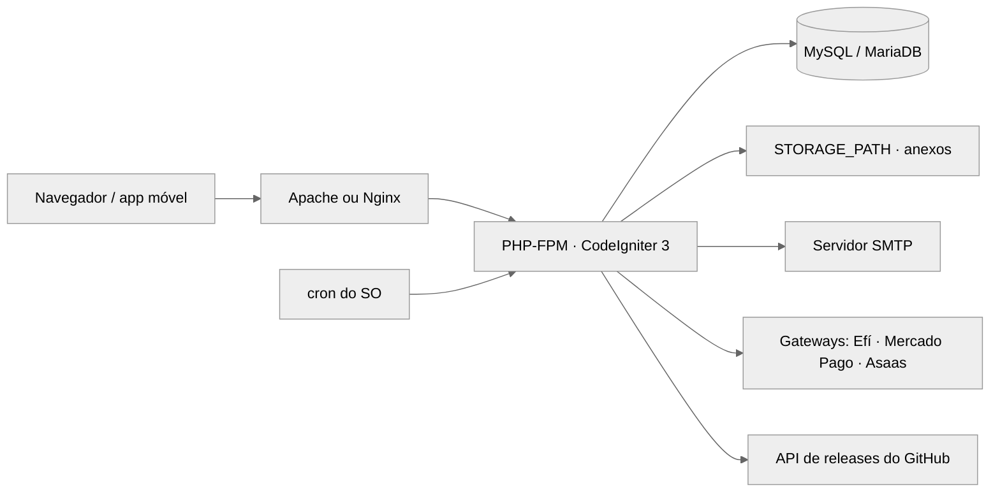

O `setup` instala só as dependências PHP; o banco e o `application/.env` nascem pelo instalador web (passo a passo abaixo). `start` e `stop` valem para o ambiente Docker; fora dele, o servidor é Apache ou Nginx apontando para a raiz do projeto.

## Pré-requisitos

- PHP 8.5 ou superior com as extensões `curl`, `gd` e `mbstring` (o `composer.json` exige `ext-curl` e `ext-gd`)
- Composer 2
- MySQL ou MariaDB (o Docker usa MySQL 8.4)
- Node 22 ou superior, **só** para alterar views, CSS ou bibliotecas JS; instalar o Map-OS nunca exige Node
- Docker e Docker Compose, para o ambiente de desenvolvimento em contêiner

## Setup (primeira execução)

```bash
# Pelo código-fonte (o zip da release já traz application/vendor)
composer install --no-dev          # produção; para desenvolvimento use: composer install

# Docker (ambiente de desenvolvimento)
cd docker && docker-compose up --force-recreate
# Abra http://localhost:8000/ e siga o instalador web.
# Banco no instalador: host mysql, usuário mapos, banco mapos, URL http://localhost:8000/
# (as credenciais do contêiner estão em docker/.env)
```

O instalador (`install/`) cria o banco, aplica as migrations e grava `application/.env` só para o dono do arquivo; ao terminar, ele se bloqueia (`install/instalado.lock`). **Apague a pasta `install/` do servidor depois.**

Depois da instalação:

1. Defina `STORAGE_PATH` com uma pasta **fora** da pasta pública (anexos e arquivos enviados).
2. Configure o e-mail de envio em Configurações > Sistema > E-mail.
3. Agende os cron jobs de e-mail (veja Comandos Úteis).
4. Proteja o servidor web: só `index.php` e `assets/` públicos; teste que `curl -I https://seu-dominio/application/.env` responde 403 ou 404, nunca 200 (`docs/servidor-web.md`).

## Topologia



| Serviço | Papel | Onde roda (dev / prod) |
| ------- | ----- | ---------------------- |
| nginx | Serve `index.php` e `assets/` | docker-compose / Apache ou Nginx do servidor |
| php-fpm | Executa a aplicação | docker-compose (PHP 8.5) / PHP-FPM do servidor |
| mysql | Persistência | docker-compose (MySQL 8.4, dados em `docker/data/db/mysql`) / MySQL ou MariaDB do servidor |
| phpmyadmin | Administração do banco | só docker-compose |
| cron | E-mails pendentes e com falha | contêiner php-fpm (`docker/etc/php/cron-jobs`) / crontab do servidor |

**Notas:**

- Cuide de `docker/data`: apagar a pasta apaga o banco do Docker.
- Atrás de proxy reverso, preencha `APP_PROXY_IPS` para o `X-Forwarded-Proto` valer (`docs/cookies-e-sessao.md`).
- A API REST só existe com `API_ENABLED=true`.

## Infraestrutura

```bash
cd docker && docker-compose up -d mysql phpmyadmin   # sobe banco e administração
cd docker && docker-compose stop mysql phpmyadmin    # para
```

Healthcheck do banco: `docker exec mysql mysqladmin ping --silent`. phpMyAdmin em `http://localhost:8080/`.

## Aplicação

```bash
cd docker && docker-compose up -d          # nginx, php-fpm, composer, mysql, phpmyadmin
cd docker && docker-compose down           # para tudo (os dados do banco ficam em docker/data)
```

Healthcheck da aplicação: `curl -sf -o /dev/null http://localhost:8000/`.

## Health Checks

| Serviço | Endpoint | Método | Resposta esperada |
| ------- | -------- | ------ | ----------------- |
| Aplicação | `http://localhost:8000/` | GET | 200 ou redirecionamento para `login` (ou para o instalador antes de instalar) |
| API | `/index.php/api/v1` | GET | 401 ou 403 sem token; 404 com `API_ENABLED=false` |

## Comandos Úteis

```bash
# Testes e qualidade (a partir da raiz)
composer test                      # PHPUnit (tests/Unit)
composer analyse                   # PHPStan nível 5 com baseline
composer format                    # php-cs-fixer
php scripts/check-escape.php       # reprova saída sem e() nas views
php scripts/check-inline-script.php  # reprova <script> inline novo
npm run test:js                    # testes de JS (node:test)

# Front-end (só ao mudar view, CSS ou JS de biblioteca)
npm ci && npm run build            # recompila assets/dist e assets/vendor; commitar a saída
npm run watch:css                  # recompila o app.css ao editar

# Banco
php index.php tools migrate        # aplica as migrations pendentes (ou Configurações > Sistema)
php index.php tools migration "nome"   # cria uma migration nova
php index.php tools seed "Usuarios"    # roda um seed de desenvolvimento

# Cron de e-mail (ajuste o caminho do index.php)
*/2 * * * * php /var/www/html/index.php email/process
*/5 * * * * php /var/www/html/index.php email/retry

# Logs
tail -f application/logs/log-$(date +%F).php
docker-compose -f docker/docker-compose.yml logs -f php-fpm
```

## Integrações Externas

| Serviço | Finalidade | Autenticação |
| ------- | ---------- | ------------ |
| Servidor SMTP | Envio de e-mails do sistema | usuário e senha em `EMAIL_SMTP_*` |
| Efí (Gerencianet) | Boleto, Pix e cobranças | client id e secret em `PAYMENT_GATEWAYS_EFI_*` |
| Mercado Pago | Cobranças | access token em `PAYMENT_GATEWAYS_MERCADO_PAGO_*` |
| Asaas | Cobranças | API key em `PAYMENT_GATEWAYS_ASAAS_*` |
| GitHub Releases | Atualização do sistema (zip e SHA256) | pública, só HTTPS verificado |

## Troubleshooting

| Sintoma | Causa provável | Solução |
| ------- | -------------- | ------- |
| Painel mostra "banco desatualizado" (503) | Migrations pendentes após atualizar | Configurações > Sistema > Atualizar banco de dados, ou `php index.php tools migrate` |
| Tela em branco ou erro 500 | Exceção em produção sem detalhe na tela | Ver `application/logs`; em development, `WHOOPS_ERROR_PAGE_ENABLED=true` |
| API responde 404 em toda rota | `API_ENABLED` desligado | Defina `API_ENABLED=true` no `application/.env` |
| API responde 503 | `API_JWT_KEY` vazia, curta ou igual ao exemplo | Gerar chave nova em Configurações > Sistema ou editar o `.env` (mínimo 32 caracteres) |
| E-mails não saem | Cron não agendado ou SMTP errado | Conferir os cron jobs e `EMAIL_SMTP_*`; ver a fila em Configurações > E-mails |
| Cookie ou login perdido atrás de proxy | `APP_PROXY_IPS` vazio | Listar o IP do proxy em `APP_PROXY_IPS` |
| CI falha em `check-escape` ou `check-inline-script` | Saída sem `e()` ou `<script>` inline novo | Escapar a saída ou mover o JS para `assets/js/modules`; nunca subir os baselines |
| CI falha em CSS defasado | `assets/dist` não recompilado | `npm ci && npm run build` e commitar |


